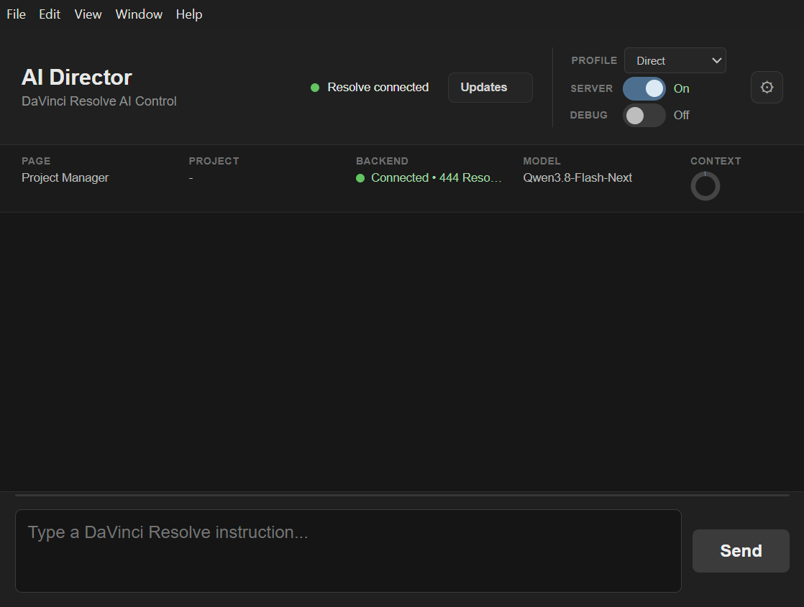

# DaVinci Resolve AI Director

DaVinci Resolve AI Director is a local-first Windows companion for DaVinci Resolve. It runs supported GGUF models on your own machine and connects them to controlled Resolve automation through a standalone desktop application.

  

## What it does

- runs local GGUF models through managed llama.cpp-derived runtimes;
- provides **Direct** and **Upstream** runtime profiles;
- connects to DaVinci Resolve through a managed MCP/backend;
- offers an optional Resolve Workflow Integration launcher;
- supports transactional runtime updates with health checks and rollback;
- can use an external FFmpeg/FFprobe installation for media operations.

## Requirements

- Windows x64;
- a supported NVIDIA GPU and compatible driver;
- at least one local GGUF model;
- DaVinci Resolve for Resolve automation;
- FFmpeg only if you want FFmpeg-backed media features.

RAM, VRAM and storage requirements depend on the model, quantization and context size. See [Installation](docs/user/INSTALLATION.md) and [Local Models](docs/user/MODELS.md) for details.

## Install

1. Download the **latest release** from [GitHub Releases](https://github.com/nikolaoskalomiris/davinci-resolve-ai-director/releases/latest).
2. Run the main AI Director installer.
3. Leave **Resolve Integration** enabled if you want to launch AI Director from DaVinci Resolve.
4. Start AI Director and choose a runtime profile and local model.

> **Upgrading:** uninstall the existing AI Director application before installing a newer release. If Resolve Integration is installed, uninstall that Windows entry too, then reinstall it with the new release.

If Windows SmartScreen warns about the installer, confirm that it came from the official release page and follow [Release Verification](docs/release/RELEASE_VERIFICATION.md). Signing status is stated on each release.

## Runtime profiles

- **Direct** is the pinned product runtime.
- **Upstream** is the independently updateable runtime.

Both use the selected local model. See [Direct and Upstream Runtimes](docs/user/RUNTIMES.md).

## Documentation

- [Project Wiki](https://github.com/nikolaoskalomiris/davinci-resolve-ai-director/wiki)
- [Installation](docs/user/INSTALLATION.md)
- [Local Models](docs/user/MODELS.md)
- [FFmpeg](docs/user/FFMPEG.md)
- [Resolve Integration](docs/user/RESOLVE_INTEGRATION.md)
- [Runtimes](docs/user/RUNTIMES.md)
- [Updates and Rollback](docs/user/UPDATER_AND_ROLLBACK.md)
- [Troubleshooting](docs/user/TROUBLESHOOTING.md)
- [Build from Source](docs/build/BUILDING.md)
- [Release Verification](docs/release/RELEASE_VERIFICATION.md)
- [Release Provenance](docs/release/RELEASE_PROVENANCE.md)

## Privacy, security and licensing

AI Director is designed for local operation. The normal inference path does not upload model weights to a hosted inference service. Update checks and managed dependency updates do use external network services; see [PRIVACY.md](PRIVACY.md).

Security reporting is described in [SECURITY.md](SECURITY.md). First-party source and documentation are Apache-2.0 unless a file says otherwise. Third-party components retain their own licenses and notices; see [LICENSE](LICENSE) and [THIRD_PARTY_NOTICES.md](THIRD_PARTY_NOTICES.md).

DaVinci Resolve is a product/trademark of Blackmagic Design Pty Ltd. NVIDIA and CUDA are trademarks of NVIDIA Corporation. This project is not an official Blackmagic Design or NVIDIA product.
